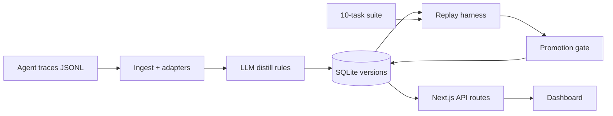

# PlaybookForge

**Author:** [Shine Gupta](https://github.com/Shine-5705) · Founder, Adaply  
**License:** MIT  
**Hackathon:** HackerSquad AI Remote Hackathon (deadline Nov 15, 2026 11:59 PM PST)

PlaybookForge turns failed **coding-agent run traces** into **versioned, replay-tested playbook rules** you can promote or roll back in one click. It ships with a **10-task benchmark suite**, a **Python replay harness**, **SQLite rule storage**, and a **Next.js dashboard**.

## Problem

Agents repeat the same mistakes across runs. Lessons from failures rarely live in a **tested, versioned, reversible** form. PlaybookForge closes that loop: ingest traces → distil rules → replay with/without rules → promote only on measured improvement.

## Quick start (< 5 commands)

```bash
git clone <your-repo-url> playbookforge && cd playbookforge
cp .env.example .env          # DEMO_MODE=true by default (offline)
npm install
npm test                      # Python unit + bundled task harness tests
npm run dev                   # seeds SQLite demo + opens dashboard on :43123
```

Open **http://127.0.0.1:43123** — the dashboard loads seeded rules and **simulated** replay metrics.

### Optional live LLM distillation

```bash
export DEMO_MODE=false
export OPENAI_API_KEY=sk-...   # or ANTHROPIC_API_KEY=sk-ant-...
PYTHONPATH=backend python3 -m playbookforge.cli distill data/sample_traces.jsonl
```

## Architecture



| Layer | Path | Role |
|-------|------|------|
| Ingest | `backend/playbookforge/ingest.py` | Generic JSONL + Claude Code + OpenHands adapters |
| Distill | `backend/playbookforge/distill.py` | OpenAI or Anthropic via env; `DEMO_MODE` deterministic fallback |
| Replay | `backend/playbookforge/replay.py` | Baseline vs rule-injected pass rate, tokens, wall time |
| Promotion | `backend/playbookforge/promote.py` | Promote only if pass rate ↑ and no per-task regression |
| Store | `backend/playbookforge/store.py` | Versioned rules + replay payloads in SQLite (`data/playbookforge.db`) |
| UI | `app/`, `components/playbook-dashboard.tsx` | Timeline, charts, per-task diffs, promote/rollback |

## CLI

```bash
export PYTHONPATH=backend DEMO_MODE=true
python3 -m playbookforge.cli seed
python3 -m playbookforge.cli ingest data/sample_traces.jsonl
python3 -m playbookforge.cli distill data/sample_traces.jsonl
python3 -m playbookforge.cli replay <rule_id>
python3 -m playbookforge.cli promote <rule_id> --version 2
python3 -m playbookforge.cli rollback <rule_id>
python3 -m playbookforge.cli export --out data/dashboard_export.json
```

## Bundled task suite

Ten self-contained Python micro-tasks under `tasks/task-01` … `tasks/task-10` (bugs + pytest + `run_agent_stub.py`). The replay harness injects candidate rules via `PLAYBOOK_RULE`.

## DEMO_MODE & simulated benchmarks

When `DEMO_MODE=true` (default):

- Rule distillation uses **deterministic pattern extraction** (no API key).
- Replay uses a **labelled simulated agent** with deterministic pass probabilities.

The UI and this README mark these numbers as **simulated** — they are for demo narrative only, not real agent benchmarks.

## Environment variables

| Variable | Description |
|----------|-------------|
| `DEMO_MODE` | `true` → offline deterministic distill + simulated replay (default) |
| `OPENAI_API_KEY` | Optional live distillation (gpt-4o-mini) |
| `ANTHROPIC_API_KEY` | Optional live distillation (claude-3-5-haiku) |

## Built during Nov 6–15, 2026

All application code in this repository was authored **November 6–15, 2026** for the HackerSquad AI Remote Hackathon. No prior PlaybookForge codebase was imported.

**Prior work:** none (greenfield hackathon submission).

## Third-party components & AI assistants

| Component | License | Use |
|-----------|---------|-----|
| Next.js 15, React 19 | MIT | Dashboard |
| Tailwind CSS, shadcn/ui, Recharts | MIT | UI + charts |
| Python 3.11+ stdlib | PSF | Backend harness |
| pytest | MIT | Tests |

**AI assistants:** Architecture and implementation were pair-programmed with **Cursor Cloud Agent** during the hackathon window. Optional runtime distillation uses **OpenAI** or **Anthropic** APIs when keys are provided.

## Screenshots

- `docs/dashboard-overview.png` — main dashboard (pass-rate chart, rule timeline, promote/rollback)
- `docs/dashboard-timeline.png` — full-page capture for judges

## Tests

```bash
npm test
```

Runs `backend/tests/*` and the bundled `tasks/test_runner.py` integration check.
